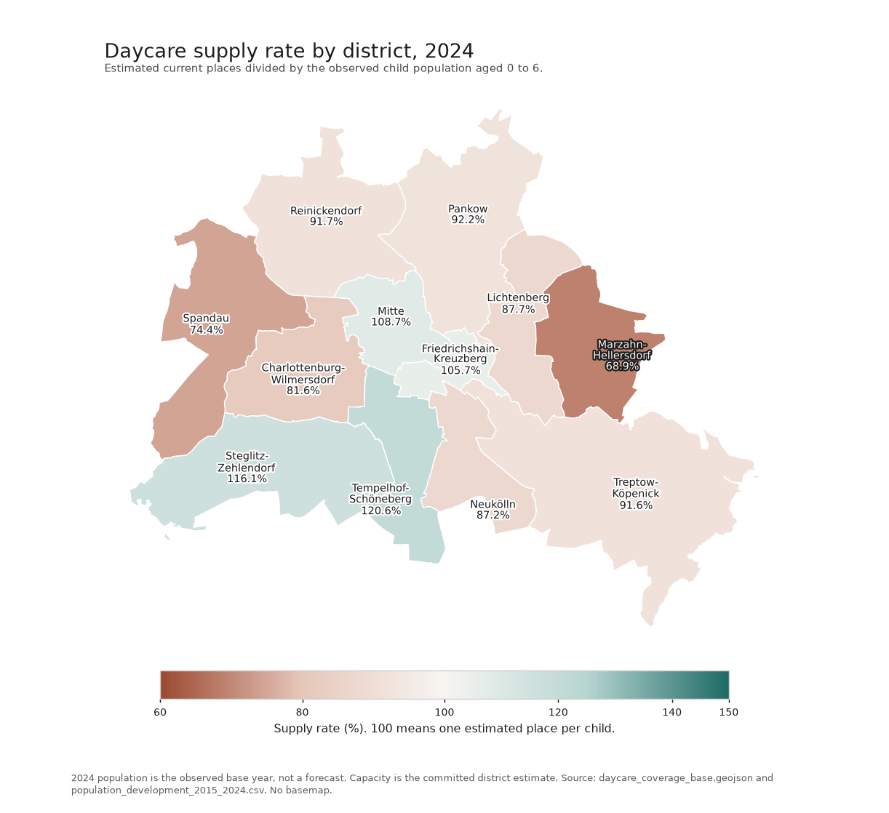
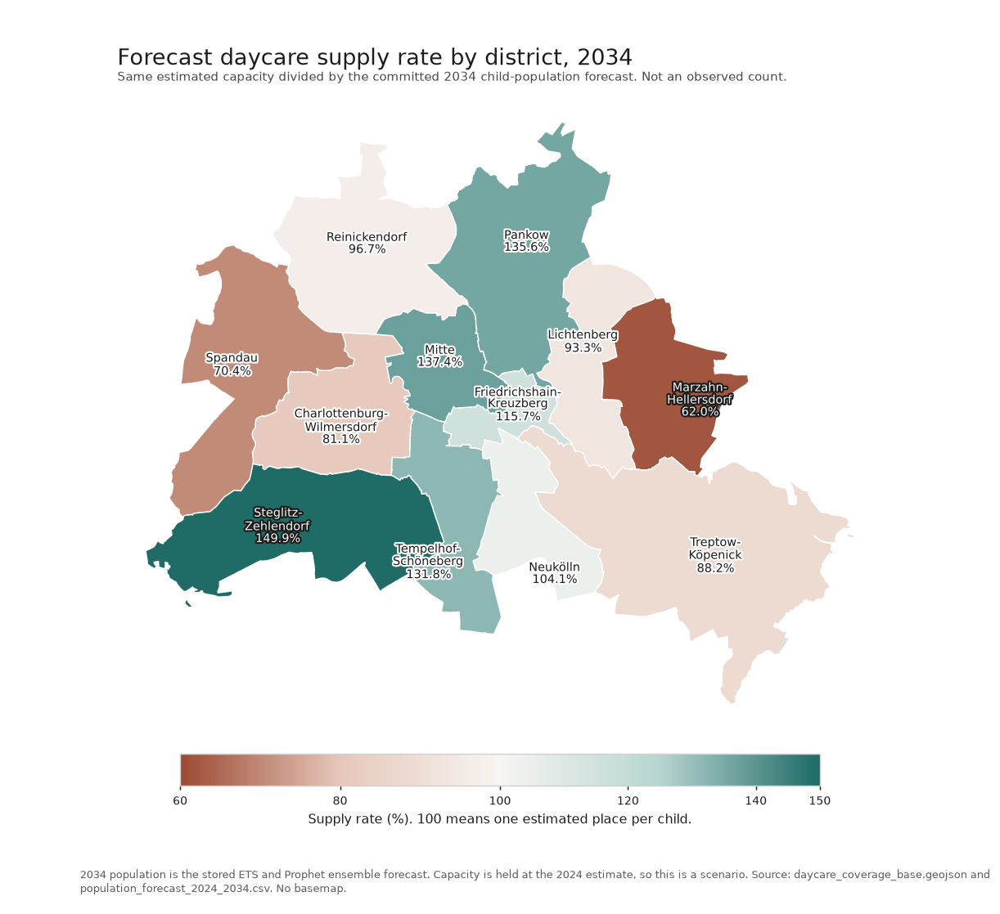

# KitaMap Berlin - Daycare Center Spatial Analysis

[](https://www.python.org/downloads/)
[](LICENSE)
[]()
[]()

> **Comprehensive spatial analysis of daycare center coverage in Berlin using GIS technology, including demographic forecasting until 2034**

The former interactive CARTO dashboard is no longer publicly available. [Key Results](#key-results) replaces it with three static figures: the 2024 supply rate, the 2034 forecast, and the change between them. The figures are not interactive.

## Quick Start

```bash
# 1. Clone the repository
git clone https://github.com/silas-workspace/KitaMap_Berlin.git
cd KitaMap_Berlin

# 2. Install dependencies
pip install -r requirements.txt

# 3. Run the complete analysis
python main.py

# 4. Explore Jupyter notebooks
jupyter notebook notebooks/
```

## Project Overview

KitaMap Berlin is a data-driven project that analyzes the spatial distribution and accessibility of daycare centers in Berlin. The project combines GIS workflows, demographic forecasting, and interactive visualization to support urban planning and policy decisions.

### Key Features

- **📊 Coverage Analysis**: District-level assessment of current daycare availability
- **🔮 Demographic Forecasting**: Population-based demand prediction until 2034
- **📍 Gap Identification**: Detection of underserved areas and hotspots
- **🚶‍♀️ Accessibility Analysis**: Walking-distance catchment area calculations
- **🌱 Environmental Integration**: Proximity analysis to green spaces and water areas
- **📱 Static result figures**: District supply maps for 2024, the 2034 forecast, and the change between them

## Technology Stack

### Core Technologies
- **Python 3.8+** - Primary programming language
- **GeoPandas** - Spatial data analysis and manipulation
- **Pandas & NumPy** - Data processing and numerical computations
- **Shapely** - Geometric operations and spatial calculations

### GIS & Mapping
- **CARTO** - Former interactive dashboard. The public map is no longer available.
- **OpenStreetMap** - Base map data and point-of-interest extraction
- **OpenRouteService API** - Isochrone and routing calculations
- **OSMium** - High-performance OSM data processing

### Analysis & Forecasting
- **Prophet** - Time series forecasting for demographic predictions
- **Statsmodels** - Statistical modeling and regression analysis
- **Scikit-learn** - Machine learning utilities
- **Matplotlib & Seaborn** - Statistical visualizations

### Development Environment
- **Jupyter Notebooks** - Interactive analysis and documentation
- **TQDM** - Progress bars for long-running operations
- **Python-dotenv** - Environment variable management
- **Ruff / Pyright / Nox** - Linting, type checking, and task automation

## Project Structure

```text
KitaMap_Berlin/
├── AGENTS.md
├── LICENSE
├── README.md
├── main.py
├── noxfile.py
├── pyproject.toml
├── requirements.txt
├── run_analysis.py
├── data/
│   ├── external/
│   │   └── README.md
│   ├── processed/
│   │   └── README.md
│   ├── raw/
│   │   └── README.md
│   └── results/
│       └── README.md
├── docs/
│   └── methodology.md
├── notebooks/
│   ├── 01_daycare_data_processing.ipynb
│   ├── 01_daycare_data_processing.py
│   ├── 02_demographic_forecasting.ipynb
│   ├── 02_demographic_forecasting.py
│   ├── 03_district_analysis.ipynb
│   ├── 03_district_analysis.py
│   ├── 04_spatial_analysis.ipynb
│   ├── 04_spatial_analysis.py
│   └── README.md
└── src/
    ├── __init__.py
    ├── config.py
    └── spatial_analysis.py
```

## Usage Examples

### Command Line Analysis
```bash
# Run complete spatial analysis
python main.py

# Extract only OSM areas (green spaces, water bodies)
python run_analysis.py --osm-only

# Generate isochrones only (requires API key)
python run_analysis.py --isochrones-only --api-key YOUR_ORS_KEY
```

### Jupyter Notebooks
The project includes four analysis notebooks:

1. **`01_daycare_data_processing.ipynb`** - Daycare data cleaning and capacity estimation
2. **`02_demographic_forecasting.ipynb`** - Population forecasting until 2034
3. **`04_spatial_analysis.ipynb`** - OSM area extraction and isochrone generation
4. **`03_district_analysis.ipynb`** - District coverage analysis and CARTO exports

Run them in this order: **01 → 02 → 04 → 03**.

### API Configuration
For isochrone generation, set your OpenRouteService API key:
```bash
export OPENROUTESERVICE_API_KEY="your_api_key_here"
```

## Data Sources

| Source | Description | Usage |
|--------|-------------|-------|
| **OpenStreetMap** | Daycare locations and metadata | Geocoding, facility data extraction |
| **Berlin Geoportal** | Administrative boundaries | District boundaries, spatial references |
| **Berlin Statistics Office** | Demographic data | Population forecasts and trends |
| **OpenRouteService** | Routing and accessibility | Isochrone calculations, walking distances |

## Methodology

### 1. Data Collection & Processing
- Automated extraction of daycare locations from OpenStreetMap
- Capacity estimation using area-based regression and district-specific medians
- Integration of demographic data at district level

### 2. Spatial Analysis
- **Catchment Areas**: 500 m walking-distance isochrones around facilities
- **Accessibility Analysis**: Route-based calculations via OpenRouteService API
- **Coverage Assessment**: District-level availability metrics

### 3. Forecasting
- **Time Series Modeling**: Prophet-based population predictions until 2034
- **Demand Estimation**: Future daycare needs based on demographic trends
- **Gap Analysis**: Identification of supply-demand mismatches

### 4. Visualization
- **Static figures**: District supply maps in this README. The former CARTO dashboard is no longer publicly available.
- **Statistical Graphics**: Analysis reports with Matplotlib/Seaborn
- **Jupyter Integration**: Reproducible analysis workflows

For full methodological detail, see [docs/methodology.md](docs/methodology.md).

## Key Results

These three figures are the static replacement for the former public dashboard. They use one supply-rate definition for every district: estimated current daycare places divided by the number of children aged 0 to 6, in percent. A value of 100 means one estimated place per child. The 2024 child count is the observed base year in `data/raw/population_development_2015_2024.csv`. The 2034 child count is the committed ETS and Prophet ensemble forecast in `data/processed/population_forecast_2024_2034.csv`. Capacity stays at `Gesamtkapazität` in `data/external/daycare_coverage_base.geojson`, so the 2034 map is a scenario, not an observed count. Districts are joined on `Bezirk`. Map labels are rounded to one decimal after the rates and the percentage-point change are calculated. Spatial coverage (`Abdeckung`) is a separate area percentage and is not the color scale.






Regenerate the three figures from the committed files:

```bash
python docs/plot_supply_figures.py
```

### Supply rate in 2024
Tempelhof-Schöneberg (120.6%), Steglitz-Zehlendorf (116.1%), Mitte (108.7%), and Friedrichshain-Kreuzberg (105.7%) are above 100%. Marzahn-Hellersdorf (68.9%) and Spandau (74.4%) are the lowest. In `data/external/daycare_coverage_category_2024.geojson`, those two districts are stored as `Unterversorgt`. Neukölln is 87.2% and stored as `Gut versorgt`. Charlottenburg-Wilmersdorf is 81.6% and stored as `Ausreichend versorgt`.

### 2034 forecast
With capacity held constant, the forecast rate falls in Marzahn-Hellersdorf to 62.0% (`Kritisch unterversorgt` in `daycare_coverage_category_2034.geojson`) and in Spandau to 70.4% (`Unterversorgt`). The largest increases are Pankow (+43.4 percentage points), Steglitz-Zehlendorf (+33.7 percentage points), and Mitte (+28.7 percentage points), where the committed child-population forecast declines. The child-population forecast rises in Marzahn-Hellersdorf, Spandau, Treptow-Köpenick, and Charlottenburg-Wilmersdorf.

## Applications

- **Urban Planning**: Evidence-based location planning for new facilities
- **Policy Making**: Data-driven resource allocation decisions
- **Research**: Methodological framework for similar urban analyses
- **Public Transparency**: Clear visualization of service coverage

## Installation

### Prerequisites
- Python 3.8 or higher
- Git

### Setup
```bash
# 1. Clone the repository
git clone https://github.com/silas-workspace/KitaMap_Berlin.git
cd KitaMap_Berlin

# 2. Create virtual environment (recommended)
python -m venv venv
source venv/bin/activate  # Linux/Mac
# or
venv\Scripts\activate     # Windows

# 3. Install dependencies
pip install -r requirements.txt

# 4. Run analysis
python main.py
```

Before running the full workflow:
- Download `berlin-latest.osm.pbf` from https://download.geofabrik.de/europe/germany/berlin.html and place it in `data/raw/`. The file is not tracked because it is large.
- Ensure `data/raw/daycare_centers_osm.geojson` is present before running Notebook 01.

## License

MIT. See [LICENSE](LICENSE).

## Author

**Silas Pignotti**
- GitHub: [@silas-workspace](https://github.com/silas-workspace)
- Project: [KitaMap Berlin](https://github.com/silas-workspace/KitaMap_Berlin)

## Acknowledgments

- **OpenStreetMap Community** for comprehensive geospatial data
- **Berlin Geoportal** for administrative boundaries
- **Berlin Statistics Office** for demographic data
- **CARTO** for visualization platform
- **OpenRouteService** for routing and accessibility APIs
